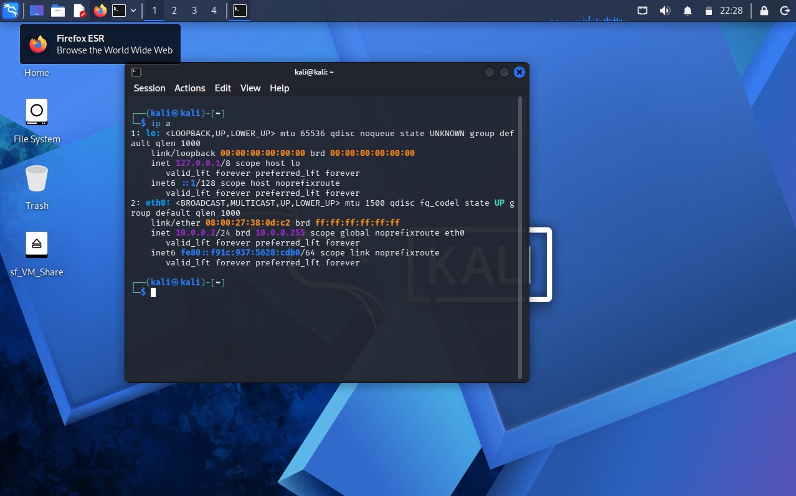

# NETWORKWALKS-Momina-B084J-W1-CyberSecurity-Lab-Setup
Cybersecurity Lab Setup using Virtualbox and Kali linux

---

## Overview

This repository showcases the setup of a secure, isolated practice lab designed for ethical hacking and penetration testing.
The environment runs Kali Linux inside Oracle VirtualBox after extracting pre-built virtual machine files using 7-Zip.

Connected through a private network, this sandboxed configuration allows new target systems to be easily introduced later for hands-on security training.

---


## Objectives

The main objectives of this project are to:
* Install the program on your laptop that lets you run virtual computers.
* Unpack the pre-made Kali Linux files and add them into the program.
* Make a secure, private network just for your virtual machines.
* Plug your Kali Linux machine into that private network.
* Give Kali a permanent address (`10.0.0.2`) so it always stays the same.
* Check that the machine can successfully connect to the internet and open websites.
* Save a clean backup snapshot so you can easily reset everything if something breaks.
* Write down all the steps you took and how you solved any problems.
* Build a solid foundation that is ready for adding more test computers later.

---

## Tools Used

| Tool | What It Does |
| --- | --- |
| **7-Zip** | Program used to open and unpack the compressed folder. |
| **VirtualBox** | The app that runs virtual computers and builds the private network. |
| **Kali Linux** | The security system used for testing and hacking labs. |
| **PowerShell & VBoxManage** | Command tools used to manage network settings. |
| **NetworkManager** | Built-in app to check network connections inside Kali. |
| **Firefox** | Web browser used to test if the virtual machine can reach the internet. |

---

## Lab Setup Procedure

## Step 1.
The compressed Kali Linux package was opened and extracted on the host laptop using the 7-Zip utility.

## Step 2.
Oracle VM VirtualBox was installed to serve as the local hypervisor platform.

## Step 3.
A specialized isolated network was set up inside VirtualBox.

* **Settings:** Network Name: `NatNetwork` | IPv4 Prefix: `10.0.0.0/24` | DHCP: Enabled | IPv6: Disabled

A NAT Network allows multiple virtual systems on the same internal subnet to talk to each other while still reaching the outside internet, creating the ideal layout for future attacker and victim machines.


## Step 4.
The Kali Linux image was downloaded from the official source and added to VirtualBox.

* **Adapter Settings:** Adapter 1 connected to `NatNetwork` using an Intel PRO/1000 MT Desktop adapter.
* **Resources:** Assigned 2048 MB of RAM.
* A shared directory was also enabled to easily move files back and forth between the host system and the virtual machine.


## Step 5.
The network settings inside Kali Linux were configured to use a fixed IPv4 address.

* **IP Address:** `10.0.0.2`
* **Subnet Mask:** `255.255.255.0`
* **Gateway:** `10.0.0.1`
* **DNS Server:** `8.8.8.8`

Having a fixed address makes documentation cleaner and ensures you can easily reference your attacking machine in upcoming labs.



## Step 6.
Once everything was configured, a recovery checkpoint was captured in VirtualBox.

* **Snapshot Title:** `Snapshot 1`
* This acts as a reliable baseline. If any future experiment breaks the system, you can instantly revert back to this working state.


---

## Lab Verification

| Test Type | Command | Expected Outcome |
| --- | --- | --- |
| **Check IP Address** | `ip a` | Displays the correct Kali IP (`10.0.0.2`) |
| **Test Gateway** | `ping 10.0.0.1` | Receives successful reply packets |
| **Test Internet** | `ping 8.8.8.8` | Receives successful public replies |
| **Test DNS** | `nslookup networkwalks.com` | Resolves domain name successfully |
| **Check Nmap** | `nmap --version` | Shows installed tool version details |
| **Verify Snapshot** | Restore & run `ip a` | Restores original working network configuration |

---

## Troubleshooting & Solutions

**Issue: Web Traffic Fails After Static IP Setup**

* **Cause:** NetworkManager duplicate address checking can occasionally block traffic on newly configured static interfaces.
* **Fix:** Ran the following command in the Kali terminal:
```bash
sudo nmcli connection modify "Wired connection 1" ipv4.dad-timeout 0

```

Afterwards, the network connection was restarted and internet access resumed.

---

## What I Learned

1. **Private vs. Standard Networks:** Learned how a NAT Network bridges internal machine-to-machine communication with external web access.
2. **Virtual Networking:** Gained practice connecting virtual adapters and managing internal subnets.
3. **Static Addressing:** Learned how to manually assign and test IP configurations inside Linux.
4. **Disaster Recovery:** Understood the value of saving baseline system checkpoints before trying risky tasks.
5. **Project Documentation:** Realized how vital clear notes, command logs, and troubleshooting steps are for technical projects.

---


## Author

**Momina Khan**

Cybersecurity & Digital Forensics Student, IUB | Networkwalks Intern

LinkedIn: https://www.linkedin.com/in/momina-khan-5793453aa/

---

## Project Information

* **Program:** Networkwalks Cybersecurity Internship
* **Week:** Week 01
* **Project:** Cybersecurity & Pentesting Lab Setup
* **Platform:** GitHub
